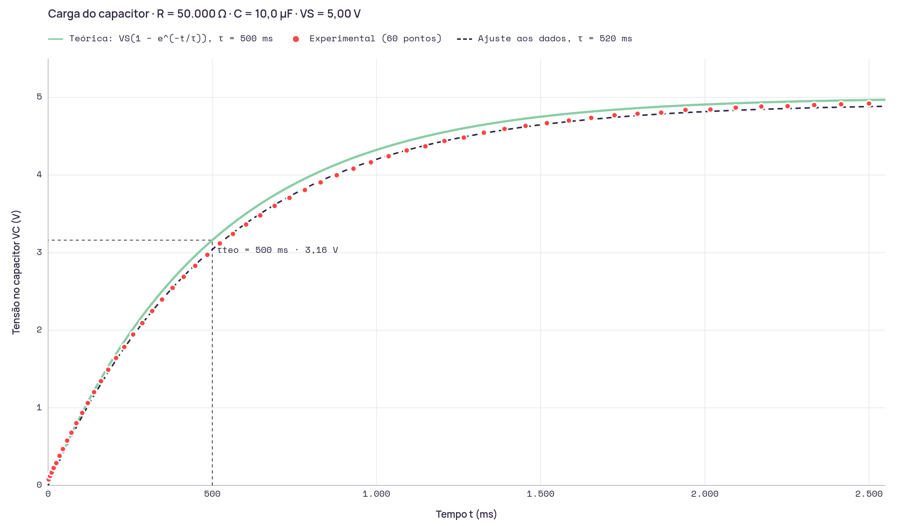

# Relatório da Ponderada 1 · Circuito RC de carga

**Aluno:** Matheus Viana de Almeida · matheus.almeida@sou.inteli.edu.br
**Turma:** T24 · **Bancada:** 1125
**Previsão registrada em:** 20/10/2026, 11:06:35
**Primeiro dado registrado em:** 20/10/2026, 10:30:04 · **atenção: previsão registrada ou alterada depois do primeiro dado**

## 1. Contextualizar (previsão)
| Grandeza | Valor |
|---|---|
| R nominal | 50000 Ω |
| C nominal | 10 µF |
| Tolerância de fábrica | 5% para o R, 10% para o C |
| Tensão da fonte V_S | 5 V |
| τ teórico (aluno) | 500 ms |
| Conta | τ = 50000 Ω x 10µf = 0.5s = 500ms |
| V_C esperada em t = τ | 3.161 V |
| Tolerância aceitável | 15 % |

**Justificativa da tolerância:** Pois todos os 4 resistores que foram utilizados no circuito possuem tolerância individual de 5%. Estando em série e utilizando os princípios das Leis de Kirchhoff, ao reduzir para um sensor único, sua tolerância unificada seria de 5%.  Além disso,deve ser levado em consideração também a margem de tolerância do capacitor, que de acordo com o professor é de 10%, o dobro do resistor.

Curva esperada: V_C(t) = 5 · (1 − e^(−t / 500 ms)). A curva teórica aparece no gráfico da etapa 4.

## 2. Consultar
- **Ferramenta:** ChatGPT
- **Pergunta (exata):** Por que a corrente no capacitor é i = C · dV/dt, e como isso, junto com a lei das malhas (VS = R·i + VC), leva à equação diferencial de primeira ordem do circuito RC?
- **O que acrescentou:** A partir da leitura do resultado entregue pela IA, eu entendi como combinar a relação da corrente no capacitor com a lei das malhas para chegar à equação diferencial de primeira ordem do circuito RC, algo que eu ainda não sabia conjuntamente, apenas isoladamente (apenas entendendo as relações de capacitâncias isoladas e as de malhas isoladas).

## 3. Construir (dados da bancada)
- **Instrumento:** Monitor serial conectado ao Arduíno Uno
- **V_S medida (final estabilizada):** 4.922 V
- **Pontos:** 60 · 27 até 1 τ teórico

| # | t (ms) | V_C medido (V) | V_C teórico (V) | Desvio (V) |
|---:|---:|---:|---:|---:|
| 1 | 0 | 0,068 | 0,000 | 0,068 |
| 2 | 1 | 0,073 | 0,010 | 0,063 |
| 3 | 2 | 0,078 | 0,020 | 0,058 |
| 4 | 6 | 0,122 | 0,060 | 0,062 |
| 5 | 11 | 0,166 | 0,109 | 0,057 |
| 6 | 17 | 0,225 | 0,167 | 0,058 |
| 7 | 25 | 0,288 | 0,244 | 0,044 |
| 8 | 35 | 0,381 | 0,338 | 0,043 |
| 9 | 45 | 0,469 | 0,430 | 0,039 |
| 10 | 58 | 0,577 | 0,548 | 0,029 |
| 11 | 71 | 0,679 | 0,662 | 0,017 |
| 12 | 86 | 0,802 | 0,790 | 0,012 |
| 13 | 104 | 0,934 | 0,939 | -0,005 |
| 14 | 121 | 1,061 | 1,075 | -0,014 |
| 15 | 140 | 1,202 | 1,221 | -0,019 |
| 16 | 161 | 1,344 | 1,377 | -0,033 |
| 17 | 183 | 1,491 | 1,532 | -0,041 |
| 18 | 207 | 1,642 | 1,695 | -0,053 |
| 19 | 232 | 1,784 | 1,856 | -0,072 |
| 20 | 259 | 1,945 | 2,021 | -0,076 |
| 21 | 287 | 2,092 | 2,184 | -0,092 |
| 22 | 317 | 2,248 | 2,348 | -0,100 |
| 23 | 347 | 2,395 | 2,502 | -0,107 |
| 24 | 379 | 2,546 | 2,657 | -0,111 |
| 25 | 413 | 2,688 | 2,811 | -0,123 |
| 26 | 448 | 2,830 | 2,959 | -0,129 |
| 27 | 485 | 2,972 | 3,105 | -0,133 |
| 28 | 523 | 3,118 | 3,243 | -0,125 |
| 29 | 563 | 3,240 | 3,378 | -0,138 |
| 30 | 603 | 3,363 | 3,503 | -0,140 |
| 31 | 646 | 3,480 | 3,626 | -0,146 |
| 32 | 690 | 3,602 | 3,742 | -0,140 |
| 33 | 735 | 3,705 | 3,850 | -0,145 |
| 34 | 782 | 3,807 | 3,954 | -0,147 |
| 35 | 830 | 3,905 | 4,049 | -0,144 |
| 36 | 879 | 3,998 | 4,138 | -0,140 |
| 37 | 930 | 4,081 | 4,222 | -0,141 |
| 38 | 983 | 4,164 | 4,300 | -0,136 |
| 39 | 1.037 | 4,242 | 4,372 | -0,130 |
| 40 | 1.092 | 4,316 | 4,437 | -0,121 |
| 41 | 1.149 | 4,370 | 4,498 | -0,128 |
| 42 | 1.207 | 4,438 | 4,553 | -0,115 |
| 43 | 1.266 | 4,482 | 4,603 | -0,121 |
| 44 | 1.327 | 4,545 | 4,648 | -0,103 |
| 45 | 1.390 | 4,594 | 4,690 | -0,096 |
| 46 | 1.454 | 4,633 | 4,727 | -0,094 |
| 47 | 1.519 | 4,668 | 4,760 | -0,092 |
| 48 | 1.586 | 4,702 | 4,790 | -0,088 |
| 49 | 1.654 | 4,736 | 4,817 | -0,081 |
| 50 | 1.725 | 4,770 | 4,841 | -0,071 |
| 51 | 1.795 | 4,790 | 4,862 | -0,072 |
| 52 | 1.867 | 4,804 | 4,881 | -0,077 |
| 53 | 1.941 | 4,839 | 4,897 | -0,058 |
| 54 | 2.017 | 4,844 | 4,911 | -0,067 |
| 55 | 2.094 | 4,868 | 4,924 | -0,056 |
| 56 | 2.172 | 4,883 | 4,935 | -0,052 |
| 57 | 2.252 | 4,888 | 4,945 | -0,057 |
| 58 | 2.333 | 4,902 | 4,953 | -0,051 |
| 59 | 2.415 | 4,912 | 4,960 | -0,048 |
| 60 | 2.500 | 4,922 | 4,966 | -0,044 |

## 4. Confrontar

| | τ |
|---|---|
| Teórico (R · C) | 500 ms |
| Experimental · linearização (44 pontos, R² = 0,9997) | 520 ms |
| Experimental · ponto de 63,2 % | 521 ms |
| **Experimental adotado** | **520 ms** |

- **V_S usada no cálculo:** 4,922 V (medida)
- **Método:** Linearização: ajuste de −ln(1 − V/Vs) × t
- **Como obtive:** Obtive o τ experimental por meio da linearização de −ln(1 − VC/VS) em função do tempo, utilizando 44 pontos medidos e a tensão estabilizada da fonte VS = 4,922 V. Foram descartados os pontos acima de 95% de VS, conforme o procedimento proposto. A partir do ajuste linear, obtive τ experimental de 520 ms, com R² = 0,9997.
- **Divergência:** +4,0 % (dentro da tolerância de 15 %)

## 5. Comprovar
**Análise da divergência:** O τ medido foi maior do que o τ  teórico: - τ teórico: 500ms - τ  experimental: 520ms Logo o experimental foi maior do que o teórico, por volta de 4% o que se enquadra dentro da margem de tolerância de 15% estabelecida.

| Causa física | Teste que a confirmaria |
|---|---|
| Os resistores de 47KΩ, e os três de 1KΩ estão com uma variação no valor nominal dentro da faixa de 5% assim como indicado pela 4ª faixa ouro do esquema de cores de cada um | Medição da resistência através do multímetro. |
| O capacitor está com uma variância da capacitância dentro da margem de 10% de tolerância. | Medição da capacitância através de um multímetro com esse recurso, ou, na ausência dessa opção, pela medição da resistência pelo multímetro |

### Pergunta de transferência (sem consulta)
- **Pergunta:** Qual é a diferença do que era esperado teoricamente e a real saída do experimento?
- **Resposta:** Existe uma diferença de 4% entre o que se esperava pro t teórico e o experimental. No geral, as medições experimentais individualmente ficaram abaixo do que o teórico.

Declaro que as medições são da bancada e que respondi a pergunta de transferência sem consulta: sim
